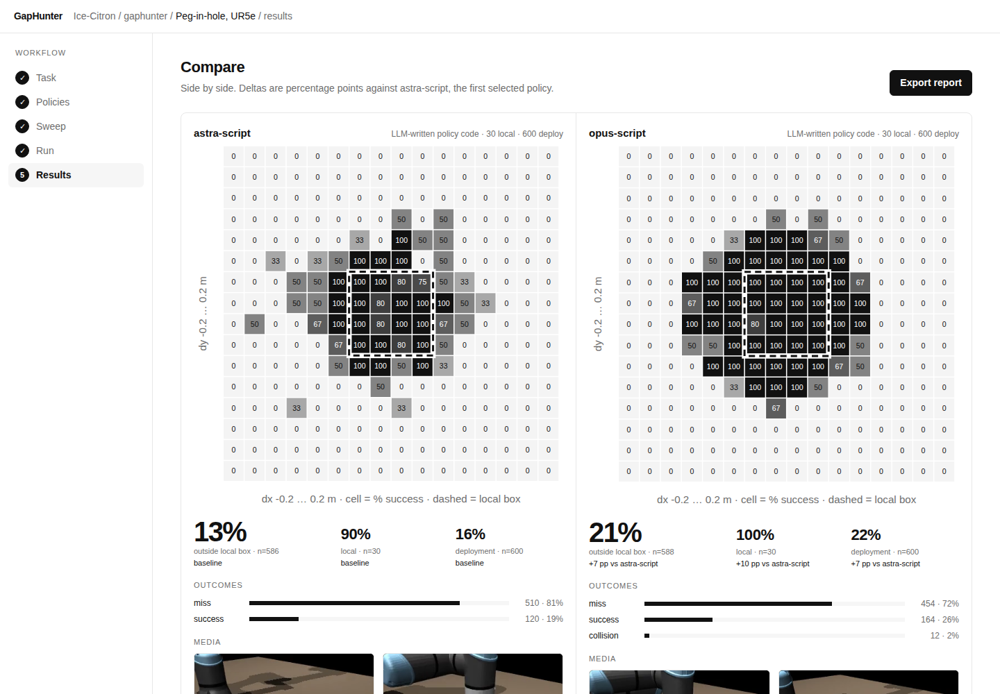

# GapHunter

**Find where your robot policy breaks before your customers do.**

### ▶ [Open the live demo](https://ice-citron.github.io/gaphunter/flow.html)

[](https://ice-citron.github.io/gaphunter/flow.html)

The demo walks through a full evaluation: pick a task, pick policies, configure the sweep, watch the trials
replay, and compare the results side by side. Every number, map and clip in it comes from the committed runs in
this repository. Also: [project page](https://ice-citron.github.io/gaphunter/).

## Why

The goal of any robotics firm is to deploy a system with four-nines (99.99%) reliability as cheaply as possible.

Foundation models are closing in on the first part of that. As LLMs like Opus improve and robotic foundation
models mature, I believe in one to two years teams will be able to zero-shot or lightly fine-tune foundation
models to get policies, for arbitrary tasks, that work 90% or 99% of the time. Yet this is not enough to deploy.

Runs of nines. Each step up the reliability ladder, 90% to 99% to 99.9% to 99.99%, is as hard as the last.
Capability gets you the first nine. The remaining nines come from finding every case where the policy breaks,
and proving you have found them.

Hence, I believe this is where the future gap in the market will be: not in building stronger base policies,
but in helping others bridge their policies from 90% to 99.99% reliability.

## What GapHunter does

I built GapHunter for this gap. You bring a policy for a defined task, and GapHunter runs coverage-driven tests
against it in simulation (MuJoCo and ManiSkill for now). It samples the full deployment workspace rather than the
range the policy was written for, and returns the policy's operating envelope: where it works, where it
degrades, where it fails, and why, with a transcript for every trial and clips of sample failures. It is the
test that tells you whether a policy is actually four-nines, and whether it is acceptable for the real world,
before a customer finds out.

Today it supports two tasks, peg-in-hole (UR5e, MuJoCo) and sphere-in-basket (Franka, ManiSkill / Ditto Bench),
and five policies have runs: an Astra-written policy, an Opus-written policy, Astra driving the arm live, Opus
driving the arm live, and MolmoAct2 (a VLA). pi0.5 is configured but its checkpoint did not download in time;
Gemini Robotics and GR00T are placeholders. Next: more generic task categories, hardware-agnostic tasks, more
simulators, and user-defined tasks and scenes.

## Results

{gap_paragraph}


*`hole_pose()` error is a modelled r³ distortion mirroring the AIC calibration radius, not a measured camera effect.*

### Policies compared

{policy_table}

{policy_status} The two peg-in-hole rows are full runs (30 local, 600 deployment trials); the sphere-task rows
are smoke runs with a handful of trials each.

## Add your own policy

| piece | contract |
|---|---|
| entry point | `run_trial(params, render=False) -> TrialResult` in `sim/trial.py` |
| `params` | `dx`, `dy` (m), `yaw` (deg): hole offset from nominal; `seed` (int) |
| `TrialResult` | `params`, `success`, `failure_mode` (`""`/`miss`/`drop`/`timeout`/`collision`/`api_error`), `n_decisions`, `t_wall` (s), `clip`, `transcript`, `pose_error_mm` |
| backend | `GAPHUNTER_SIM` = `fake` (default) / `mujoco` / `ditto` |

On MuJoCo a policy is `results/policies/<name>.py` defining `run(api)` with the four calls in `sim/api.py`:

```python
# results/policies/toy.py
def run(api):
    (x, y, z), yaw = api.hole_pose()      # camera estimate of the hole
    api.move_to((x, y, z + 0.02), yaw)    # hover 2 cm above it
    for _ in range(20):                   # descend in 4 mm steps
        api.step_down(4)                  # returns contact force (N); ignored here
        if api.done():                    # seated >= 30 mm deep
            return
```

Copy the `astra-script` entry in `runner/policies.py` `POLICIES`, set `"policy": "toy"` and drop its `*_csv` keys, then:

```bash
for box in local deploy; do GAPHUNTER_SIM=mujoco GAPHUNTER_POLICY=toy .venv/bin/python -m runner.batch --box $box --n 60 --tag $box --policy toy --seed 50000; done
.venv/bin/python -m runner.policies && .venv/bin/python -m analysis.fill_docs
```

Pick an unused `--seed`: artifacts are named by param hash, so seed 0 overwrites astra-script's. "full" needs ≥20 local and ≥50 deploy trials.

## How to reproduce

Setup (Linux, Python 3.12; no API key needed):

```bash
git clone https://github.com/Ice-Citron/gaphunter.git && cd gaphunter
python3.12 -m venv .venv
.venv/bin/pip install numpy==2.5.4 scipy==1.18.1 pandas==3.0.6 matplotlib==3.11.2 \
  streamlit==1.66.0 imageio==2.38.1 imageio-ffmpeg==0.6.0 mujoco==3.16.0
git clone --filter=blob:none --sparse https://github.com/google-deepmind/mujoco_menagerie.git third_party/mujoco_menagerie
git -C third_party/mujoco_menagerie sparse-checkout set universal_robots_ur5e
git -C third_party/mujoco_menagerie checkout 62ab00f
```

Run (about 1 minute):

```bash
export GAPHUNTER_SIM=mujoco
.venv/bin/python -m runner.batch  --box local  --n {rows_local} --tag local  --workers 8
.venv/bin/python -m runner.batch  --box deploy --n {rows_deploy} --tag deploy --workers 8 --render-failures 4
.venv/bin/python -m runner.refine --tag deploy --per-cell 10
.venv/bin/python -m analysis.fill_docs
.venv/bin/streamlit run app/streamlit_app.py
```

Shortcut:

```bash
make demo
```

Details: `sim/README.md`.

## Limitations

- Simulation only. Smoke rows have too few trials for conclusions.
- Coverage is unweighted box volume ({coverage_all} without yaw folding).
- The perception error on peg-in-hole is a model, not a measured camera.
- In the demo, uploading policies, creating tasks and the greyed simulators are not available in this build.
- On the sphere task the demo also lists the peg-in-hole runs of astra-script and opus-script, labelled as
  peg-in-hole data, for comparison. They are not sphere-task results.

## Credits

MuJoCo + [Menagerie](https://github.com/google-deepmind/mujoco_menagerie) UR5e;
[llms-for-robot-control](https://github.com/llong-cs/llms-for-robot-control) (MIT), ManiSkill 3, Ditto Bench;
Astra and Opus via API credits.

## Team

Shi Hao ([@Ice-Citron](https://github.com/Ice-Citron)) with three Claude Code agents. MicroAGI Physical AI
Hackathon, London.
