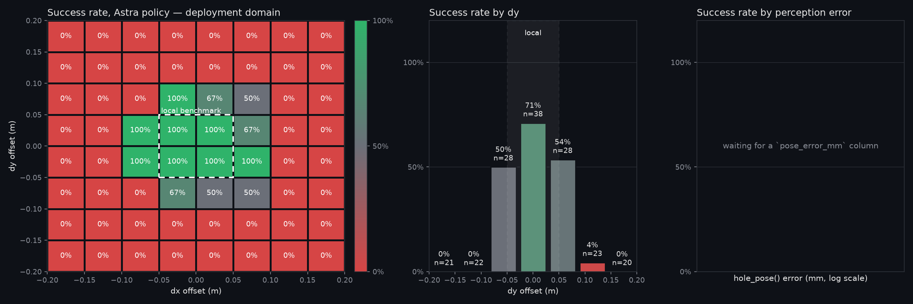

# GapHunter

**Find where your benchmark stopped before the hidden eval does.**



*`hole_pose()` error is a modelled r³ distortion mirroring the AIC calibration radius, not a measured
camera effect (0.3 mm at 5 cm, 15 mm at 20 cm).*

## Problem

In Intrinsic AIC 2026 our policy scored 141 on our local benchmark and 89 on the hidden evaluation.
The local scenes randomised the board over a radius a third smaller than the real one.
The policy did not regress; the benchmark never tested where it fails.

## What GapHunter does

**Sample → run → map → report.** GapHunter samples the hole offset (`dx`, `dy`, yaw) from the
benchmark's box and a wider deployment box, runs the policy on each sample in simulation, and maps where
it fails. Task: MuJoCo peg-in-hole on a UR5e, a 20 mm square peg into a 21 mm hole. Success is depth ≥ 30 mm with lateral error < 1 mm.

## Why Astra as the policy

Astra writes the policy once: given a four-function API (`hole_pose`, `move_to`, `step_down`, `done`),
it returns `policy.py`, which runs unchanged on every trial. LLM-written policies have no deployment
benchmarks yet.

## Two axioms

1. The goal of any robotics firm is to deploy a system with four-nines reliability as cheaply as possible.
2. Each step-up in the reliability regime — 90%, 99%, 99.9%, 99.99% — is equally difficult.

## Results

| | success | n |
|---|---|---|
| Local benchmark box | **100%** | 30 |
| Deployment box | **18%** | 150 |
| Deployment, outside the local box | **16%** | 146 |

The local benchmark covers 2.1% of the deployment domain by volume (dx × dy × yaw; yaw folded to ±45° by the peg symmetry). The policy succeeds on 100% of local trials (n=30) and 18% of deployment trials (n=150); outside the local box it succeeds on 16% (n=146). Failures concentrate in: dx ∈ [-0.20, -0.13] m (0%, n=25); dx ∈ [+0.13, +0.20] m (0%, n=25); dy ∈ [-0.20, -0.13] m (0%, n=25); dy ∈ [-0.13, -0.07] m (0%, n=25). A benchmark that stopped at the local box would have reported 100% and shipped.

Yaw is folded to ±45° because the square peg has 90° symmetry (1.0% without folding).

## How to reproduce

```bash
export GAPHUNTER_SIM=mujoco
.venv/bin/python -m runner.batch  --box local  --n 30 --tag local  --workers 8
.venv/bin/python -m runner.batch  --box deploy --n 150 --tag deploy --workers 8 --render-failures 4
.venv/bin/python -m runner.refine --tag deploy --per-cell 10
.venv/bin/python -m analysis.fill_docs
.venv/bin/streamlit run app/streamlit_app.py
```

Setup: `sim/README.md`.

## Limitations

- One task, one policy, simulation only.
- n = 150, so heatmap cells are noisy.
- Coverage is unweighted box volume.
- The perception error is our model, chosen to mirror AIC (see the heatmap caption).

**First attempt:** Astra driving a Franka on Ditto Bench's sphere-in-basket task failed our gate (0 of 6).

## Roadmap

- Adaptive boundary search.
- Astra as scenario proposer.
- intrinsic-core / ReSim open-core integration.
- Real hardware.

## Credits

MuJoCo; Astra (`gpt-6-astra`) via OpenAI credits. Ditto attempt:
[llms-for-robot-control](https://github.com/llong-cs/llms-for-robot-control) (MIT), ManiSkill 3, Ditto Bench,
MolmoAct2 assets.

## Team

Shi Hao ([@Ice-Citron](https://github.com/Ice-Citron)) with three Claude Code agents. MicroAGI Physical AI
Hackathon, London.
